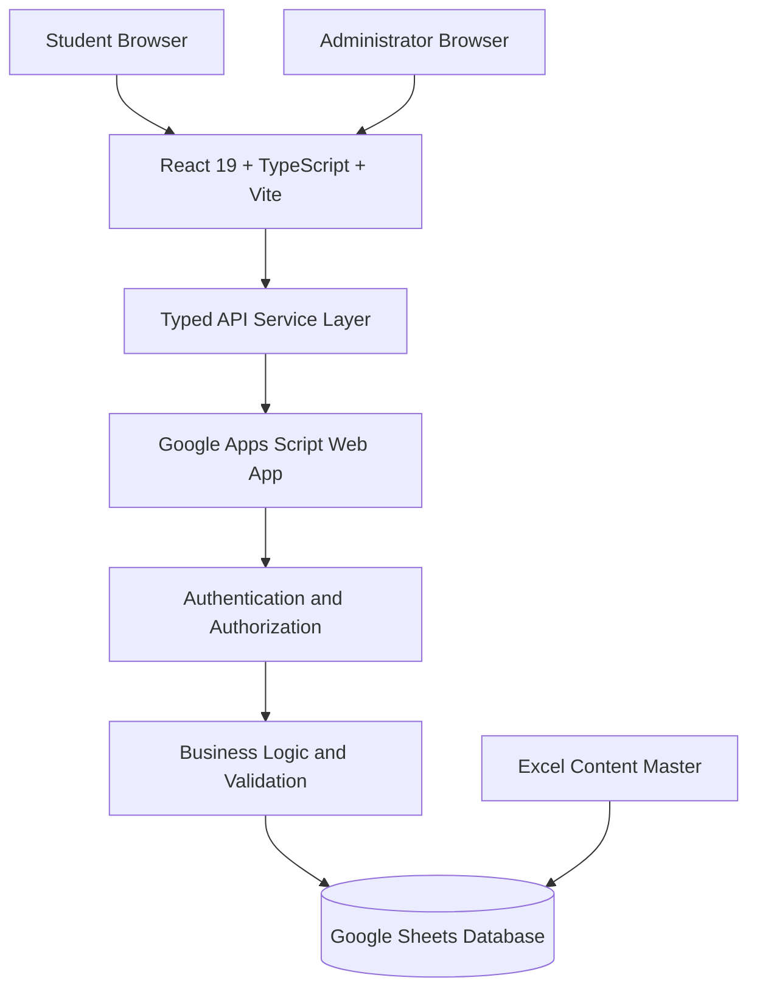

# CAREERVERSE — System Architecture

**Document Version:** 1.0.0  
**Status:** Approved Architecture Baseline  
**Project:** CAREERVERSE — University Career Guidance Platform  
**Date:** November 2026

---

## 1. Project Overview

CAREERVERSE is a web-based career guidance and learning platform designed for fewer than 50 first-year and second-year B.Tech students.

The platform delivers structured career guidance through nine learning chapters, interactive MCQ assessments, reflection activities, anonymous questions, feedback, and student progress tracking.

It includes two access levels:

- **Student:** Access chapters, complete activities, track progress, submit questions, and view results.
- **Administrator:** Manage chapters, activities, timers, responses, questions, results, and platform settings.

The initial release is designed for a university career guidance event.

## 2. Technology Stack

### Frontend

- React 19
- TypeScript
- Vite
- Tailwind CSS
- Lucide React
- React Router

### Backend

- Google Apps Script
- Apps Script Web App deployment
- Server-side request validation and authorization
- Google Apps Script services

### Database

- Google Sheets

### Content Authoring

- Microsoft Excel (.xlsx)
- Structured question and chapter data
- Controlled publishing into Google Sheets

### Version Control

- Git
- GitHub

### Hosting

- Static frontend hosting
- Google Apps Script Web App for backend operations

The architecture intentionally excludes Firebase, Supabase, MongoDB, PostgreSQL, Redis, Express, and separate Node.js or Python backend services.

## 3. High-Level Architecture



The frontend communicates with the backend through a typed API service abstraction.

The backend is responsible for authentication checks, authorization, validation, business logic, and database operations.

The frontend must never be trusted to enforce administrative permissions or protect correct quiz answers.

## 4. Frontend Architecture

The application uses React 19, TypeScript, and Vite.

### Core responsibilities

- Render student and administrator interfaces.
- Handle application navigation.
- Manage authentication state.
- Display chapter content.
- Run chapter activities and timers.
- Display progress and results.
- Submit student responses.
- Provide administrator management interfaces.

### Folder Structure

```text
src/
├── assets/
├── components/
│   ├── common/
│   ├── dashboard/
│   ├── chapters/
│   ├── activities/
│   └── admin/
├── pages/
│   ├── auth/
│   ├── student/
│   └── admin/
├── layouts/
├── hooks/
├── context/
├── services/
│   ├── api/
│   └── mock/
├── types/
├── utils/
├── data/
├── App.tsx
└── main.tsx
```

### API Service Abstraction

The frontend must use a typed service interface.

Initially, a mock implementation will provide predictable development data. Later, an Apps Script adapter will replace the mock implementation without requiring a complete frontend rewrite.

All backend requests must pass through this service layer.

## 5. Backend Architecture

Google Apps Script acts as the backend application layer.

### Backend responsibilities

1. Validate incoming requests.
2. Verify student and administrator access.
3. Enforce role-based authorization.
4. Retrieve chapter and activity data.
5. Validate MCQ submissions.
6. Calculate assessment results.
7. Record student progress.
8. Manage reflection polls and feedback.
9. Process anonymous questions.
10. Control chapter and activity availability.
11. Manage timers and leaderboard visibility.

### Request flow

```text
Frontend Request
      |
      v
Apps Script Web App
      |
      v
Request Validation
      |
      v
Authentication Check
      |
      v
Authorization Check
      |
      v
Business Logic
      |
      v
Google Sheets Operations
      |
      v
JSON Response
      |
      v
Frontend UI Update
```

The backend must independently validate every protected operation.

## 6. Database Architecture

Google Sheets is the primary database for the initial release.

Recommended worksheets:

| Worksheet | Purpose |
|---|---|
| Students | Student registration information |
| Admins | Administrator records and access configuration |
| Chapters | Nine chapter records and release status |
| Questions | MCQ questions and answer keys |
| Options | MCQ answer options |
| Activities | Reflection polls and other activities |
| Responses | Submitted assessment responses |
| Progress | Student chapter completion |
| Questions_Inbox | Anonymous student questions |
| Feedback | Student feedback |
| Settings | Timers and platform configuration |
| Audit_Log | Important administrative actions |

The exact columns, relationships, and validation rules are defined in DATABASE_SCHEMA.md.

### Data Protection

- Correct MCQ answers must never be exposed through public frontend requests.
- Administrator credentials must never be embedded in frontend source code.
- Sensitive operations must be authorized on the backend.
- Student responses must be validated before saving.
- Avoid storing unnecessary personal information.
- Protect access to the underlying Google Sheet.

## 7. Authentication and Authorization

### Student Entry

The initial student entry process uses:

- Student name
- Registration number
- Event access code

These details provide basic event access, not strong identity verification.

The backend must validate the supplied information before creating an authorized student session.

### Administrator Access

Administrators use a separate protected login mechanism.

Administrator privileges must be checked server-side for every administrative operation.

### Authorization Rules

**Student permissions:**

- View released chapters.
- Complete available activities.
- Submit answers.
- Submit questions and feedback.
- View permitted results and progress.

**Administrator permissions:**

- Manage chapters.
- Release and lock chapters.
- Open and close activities.
- Configure timers.
- Review responses.
- Review questions and feedback.
- Manage results.
- Control leaderboard visibility.
- Preview the student experience.

## 8. Chapter and Activity Architecture

The platform contains nine chapters:

1. The Master Strategy
2. The Four-Year Roadmap
3. Domains and Tools
4. Skills Mastery
5. Platforms That Build Your Proof
6. Research and AI
7. Experience and Visibility
8. Beyond Placements
9. Habits and Wrap-Up

Each chapter supports:

- Chapter introduction and learning content.
- Five single-answer MCQs.
- Answer explanations.
- Reflection activities or polls.
- Countdown timers where configured.
- Completion and progress tracking.

Chapter availability is controlled by the administrator.

## 9. Excel Content Management

Excel (.xlsx) is the master content-authoring format.

The content workflow is:

```text
Excel Master Workbook
        |
        v
Content Validation
        |
        v
Administrator Review
        |
        v
Google Sheets Publishing
        |
        v
Apps Script Backend
        |
        v
Student Application
```

Excel is used for structured content preparation and review.

Google Sheets is the live database used by the deployed application.

## 10. Security Architecture

Security must be enforced primarily on the backend.

Requirements:

- Validate all incoming request fields.
- Enforce server-side authorization.
- Keep answer keys private.
- Keep administrator credentials out of frontend code.
- Validate assessment submissions.
- Prevent unauthorized chapter access.
- Restrict administrative operations.
- Apply appropriate access permissions to Google Sheets.
- Avoid trusting client-side timers or scores.
- Record important administrative actions.

The registration number and event access code must not be treated as strong authentication credentials.

## 11. Deployment Architecture

### Frontend

Build the React application using:

```bash
npm run build
```

Deploy the generated static production files to a suitable static hosting provider.

### Backend

Deploy the Google Apps Script project as a Web App.

Configure the frontend API adapter to communicate with the deployed backend.

### Development and Production

Maintain separate development and production configurations.

Never place private credentials in public frontend environment variables.

## 12. Development Principles

1. Build the frontend using reusable React components.
2. Use strict TypeScript types.
3. Separate UI components from business logic.
4. Use a mock API during early frontend development.
5. Implement Apps Script integration after the UI and API contracts are established.
6. Validate all sensitive operations on the server.
7. Keep database operations centralized.
8. Use Git for incremental version control.
9. Test student and administrator access separately.
10. Keep the initial release within the approved project scope.

---

**Architecture Decision:** CAREERVERSE will use React 19 + TypeScript + Vite for the frontend, Google Apps Script for the backend, and Google Sheets as the live database. Excel will be used for master content authoring. This architecture is the baseline for the initial university event release.