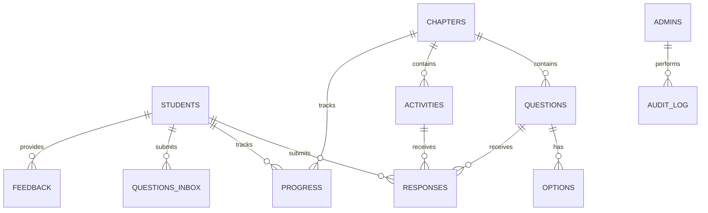

# CAREERVERSE — Database Schema Specification

**Document Version:** 1.0.0  
**Status:** Approved Database Baseline  
**Database:** Google Sheets  
**Backend:** Google Apps Script  
**Project:** University Career Guidance Platform  
**Date:** November 2026

---

## 1. Database Overview

CAREERVERSE uses Google Sheets as its primary database for the initial university career guidance event.

Google Apps Script acts as the backend data-access and business-logic layer.

Each worksheet represents a logical data table. The backend manages all reads, writes, validation, and authorization.

Excel (.xlsx) is used as the master content-authoring format. Google Sheets is the live application database.

No SQL database, ORM, database triggers, or separate database server is required.

## 2. Database Design Principles

1. Use unique identifiers for records.
2. Use consistent column names.
3. Store timestamps in ISO 8601 format.
4. Use server-side validation before writing records.
5. Keep MCQ answer keys inaccessible to student-facing requests.
6. Keep administrator access data protected.
7. Record important administrative operations.
8. Avoid unnecessary personal information.
9. Use controlled values for status and role fields.
10. Centralize database access through Google Apps Script functions.

### Identifier Strategy

Use UUID-style identifiers generated by Apps Script for primary record identifiers.

Examples:

- `student_id`
- `chapter_id`
- `question_id`
- `activity_id`
- `response_id`

Do not use spreadsheet row numbers as permanent record identifiers because rows can move or be deleted.

### Timestamp Strategy

Use ISO 8601 timestamps.

Example:

`2026-11-08T17:30:00.000Z`

Common fields:

- `created_at`
- `updated_at`
- `submitted_at`

Timestamps are generated and controlled by the backend.

## 3. Entity Relationship Overview

## 4. Worksheet Definitions

### 4.1 Students

Purpose: Store student registration and access information.

| Column | Type | Description |
|---|---|---|
| student_id | UUID | Unique student identifier |
| student_name | STRING | Student's name |
| registration_number | STRING | University registration number |
| event_code_hash | STRING | Secure event-code verification value, if stored per student |
| is_active | BOOLEAN | Student access status |
| created_at | DATETIME | Registration timestamp |
| updated_at | DATETIME | Last update timestamp |

Constraints:

- `student_id` must be unique.
- `registration_number` must be unique.
- Normalize registration numbers before comparison.
- Never expose event-code verification data to the frontend.

The event access code should be maintained as protected server-side configuration, not distributed as a student record field.

### 4.2 Admins

Purpose: Store administrator identity and access configuration.

| Column | Type | Description |
|---|---|---|
| admin_id | UUID | Unique administrator identifier |
| admin_email | STRING | Administrator email |
| credential_reference | STRING | Reference to protected credential configuration |
| role | STRING | Administrator role |
| is_active | BOOLEAN | Access status |
| created_at | DATETIME | Creation timestamp |
| updated_at | DATETIME | Update timestamp |

Constraints:

- Administrator access must be validated server-side.
- Never store plaintext passwords.
- Never expose administrator records to student requests.
- Protect the spreadsheet and Apps Script configuration.

### 4.3 Chapters

Purpose: Store the nine learning chapters.

| Column | Type | Description |
|---|---|---|
| chapter_id | UUID | Unique chapter identifier |
| chapter_number | NUMBER | Chapter order from 1 to 9 |
| title | STRING | Chapter title |
| description | STRING | Chapter introduction |
| content | TEXT | Chapter learning content |
| is_released | BOOLEAN | Whether students can access the chapter |
| display_order | NUMBER | Display sequence |
| created_at | DATETIME | Creation timestamp |
| updated_at | DATETIME | Update timestamp |

Approved chapter titles:

1. The Master Strategy
2. The Four-Year Roadmap
3. Domains and Tools
4. Skills Mastery
5. Platforms That Build Your Proof
6. Research and AI
7. Experience and Visibility
8. Beyond Placements
9. Habits and Wrap-Up

### 4.4 Questions

Purpose: Store MCQ question content and protected answer information.

| Column | Type | Description |
|---|---|---|
| question_id | UUID | Unique question identifier |
| chapter_id | UUID | Associated chapter |
| question_text | TEXT | Question |
| correct_option_id | UUID | Correct option identifier |
| explanation | TEXT | Answer explanation |
| marks | NUMBER | Question marks |
| is_active | BOOLEAN | Question availability |
| display_order | NUMBER | Question order |
| created_at | DATETIME | Creation timestamp |
| updated_at | DATETIME | Update timestamp |

Constraints:

- Each chapter contains five single-answer MCQs in the initial release.
- Correct answer information is private.
- Student API responses must exclude `correct_option_id`.
- Answer verification must happen on the backend.

### 4.5 Options

Purpose: Store answer choices for each MCQ.

| Column | Type | Description |
|---|---|---|
| option_id | UUID | Unique option identifier |
| question_id | UUID | Associated question |
| option_label | STRING | A, B, C, or D |
| option_text | TEXT | Option content |
| display_order | NUMBER | Option order |

Constraints:

- Each question has four answer options.
- Each option belongs to one question.
- The student-facing API must return option text and identifiers without revealing the correct answer.

### 4.6 Activities

Purpose: Store reflection polls and interactive chapter activities.

| Column | Type | Description |
|---|---|---|
| activity_id | UUID | Unique activity identifier |
| chapter_id | UUID | Associated chapter |
| activity_title | STRING | Activity title |
| activity_type | STRING | POLL, REFLECTION, or FEEDBACK |
| instructions | TEXT | Activity instructions |
| is_open | BOOLEAN | Activity availability |
| timer_seconds | NUMBER | Configured duration |
| display_order | NUMBER | Activity order |
| created_at | DATETIME | Creation timestamp |
| updated_at | DATETIME | Update timestamp |

### 4.7 Responses

Purpose: Store submitted MCQ answers and activity responses.

| Column | Type | Description |
|---|---|---|
| response_id | UUID | Unique response identifier |
| student_id | UUID | Student identifier |
| chapter_id | UUID | Chapter identifier |
| question_id | UUID | Question identifier, nullable for non-MCQ activities |
| activity_id | UUID | Activity identifier, nullable for MCQs |
| selected_option_id | UUID | Selected option identifier |
| response_text | TEXT | Reflection or written response |
| is_correct | BOOLEAN | Backend-calculated correctness |
| marks_awarded | NUMBER | Backend-calculated marks |
| submitted_at | DATETIME | Submission timestamp |

Constraints:

- Student identity must be verified by the backend.
- Correctness and marks must be calculated by the backend.
- Never accept client-provided scores as authoritative.
- Prevent duplicate submissions according to the configured activity rules.
- Do not return another student's private responses.

### 4.8 Progress

Purpose: Track each student's chapter completion.

| Column | Type | Description |
|---|---|---|
| progress_id | UUID | Unique progress record |
| student_id | UUID | Student identifier |
| chapter_id | UUID | Chapter identifier |
| status | STRING | NOT_STARTED, IN_PROGRESS, COMPLETED |
| questions_attempted | NUMBER | Number of attempted MCQs |
| score | NUMBER | Backend-calculated chapter score |
| completed_at | DATETIME | Completion timestamp |
| updated_at | DATETIME | Last update timestamp |

Constraints:

- One progress record per student per chapter.
- Scores must be calculated by the backend.
- Students can view only their own progress unless an authorized administrator requests aggregate results.

### 4.9 Questions_Inbox

Purpose: Store anonymous questions submitted by students.

| Column | Type | Description |
|---|---|---|
| inbox_id | UUID | Unique question identifier |
| display_reference | STRING | Anonymous public reference |
| question_text | TEXT | Submitted question |
| status | STRING | PENDING, REVIEWED, ANSWERED, ARCHIVED |
| admin_response | TEXT | Optional administrator response |
| submitted_at | DATETIME | Submission timestamp |
| reviewed_at | DATETIME | Review timestamp |

Privacy:

- Student identity must not be displayed to administrators in the ordinary anonymous-question review interface.
- Avoid collecting unnecessary identifying metadata.
- If abuse prevention requires internal technical metadata, restrict its access separately.

### 4.10 Feedback

Purpose: Collect student feedback.

| Column | Type | Description |
|---|---|---|
| feedback_id | UUID | Unique feedback identifier |
| student_id | UUID | Student identifier, nullable for anonymous feedback |
| rating | NUMBER | Optional rating |
| feedback_text | TEXT | Feedback content |
| is_anonymous | BOOLEAN | Anonymous submission flag |
| submitted_at | DATETIME | Submission timestamp |

### 4.11 Settings

Purpose: Store event and application configuration.

| Column | Type | Description |
|---|---|---|
| setting_key | STRING | Unique configuration key |
| setting_value | STRING | Configuration value |
| description | STRING | Configuration explanation |
| updated_at | DATETIME | Last update timestamp |

Suggested settings:

- `event_name`
- `event_access_enabled`
- `default_activity_timer`
- `leaderboard_enabled`
- `results_visible`
- `student_registration_enabled`

Sensitive credentials and event-code secrets must be kept in protected Apps Script configuration rather than exposed through this worksheet.

### 4.12 Audit_Log

Purpose: Record important administrator actions.

| Column | Type | Description |
|---|---|---|
| log_id | UUID | Unique log identifier |
| admin_id | UUID | Administrator identifier |
| action | STRING | Action performed |
| entity_type | STRING | Affected record type |
| entity_id | UUID | Affected record identifier |
| details | STRING | Non-sensitive action summary |
| created_at | DATETIME | Action timestamp |

Examples:

- CHAPTER_RELEASED
- CHAPTER_LOCKED
- ACTIVITY_OPENED
- ACTIVITY_CLOSED
- TIMER_UPDATED
- RESULTS_VISIBILITY_CHANGED
- LEADERBOARD_VISIBILITY_CHANGED

Never record passwords, event-code secrets, or sensitive authentication tokens in audit logs.

## 5. Data Validation Rules

### Student Records

- Student name is required.
- Registration number is required and normalized.
- Registration number must be unique.
- Inactive students cannot access protected content.

### Chapter Records

- Chapter number must be between 1 and 9.
- Chapter titles must match the approved chapter list.
- Only released chapters are available to students.

### MCQ Records

- Each chapter must have five active MCQs for the initial release.
- Each MCQ must have four options.
- Exactly one option must be correct.
- Correctness must be validated on the server.

### Response Records

- Student and chapter references must exist.
- Question and option references must match.
- Activity availability must be checked before accepting submissions.
- Scores must be calculated on the backend.

## 6. Data Access and Security

All database access must occur through Google Apps Script.

The frontend must never access the Google Sheet directly.

The backend must:

1. Validate every request.
2. Verify the current student or administrator session.
3. Check authorization for the requested operation.
4. Validate referenced record identifiers.
5. Perform permitted spreadsheet operations.
6. Return only the data required by the caller.

### Public Student Data

Student requests may receive:

- Released chapter content.
- Available question text.
- Answer options.
- Activity instructions.
- Their own progress and results.
- Public leaderboard data when enabled.

Student requests must never receive:

- MCQ correct-option identifiers.
- Administrator credentials.
- Private configuration values.
- Other students' private responses.
- Internal audit records.

## 7. Database Initialization

The initial Google Sheets workbook must contain these worksheets:

1. Students
2. Admins
3. Chapters
4. Questions
5. Options
6. Activities
7. Responses
8. Progress
9. Questions_Inbox
10. Feedback
11. Settings
12. Audit_Log

The Apps Script initialization process should verify that all required worksheets and headers exist.

Initialization must not erase existing application data.

## 8. Backup and Maintenance

- Maintain a protected master workbook.
- Create periodic backups.
- Restrict spreadsheet editor permissions.
- Review administrative access regularly.
- Validate worksheet headers before database operations.
- Avoid changing column names without updating the backend.
- Maintain consistent identifiers across worksheets.

---

**Architecture Decision:** Google Sheets is the live database for CAREERVERSE. Google Apps Script owns all database access, validation, authorization, and business logic. Excel is the master content-authoring format. This schema is the baseline for the initial university event release.